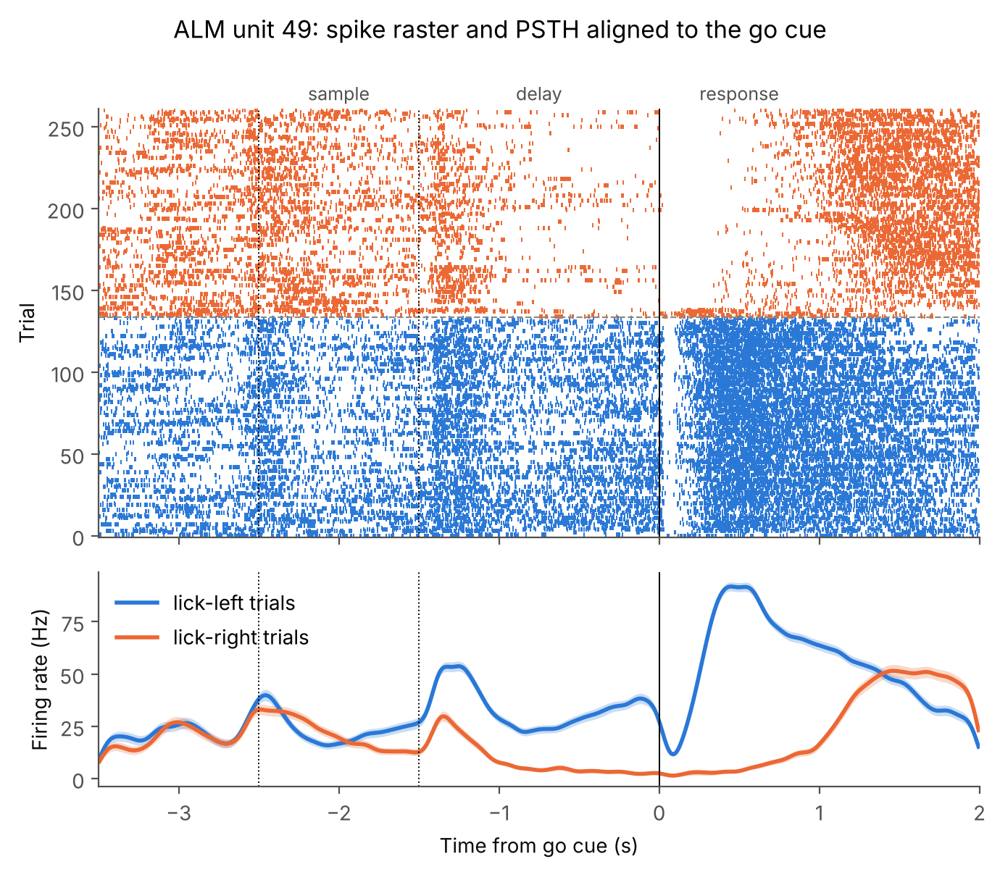
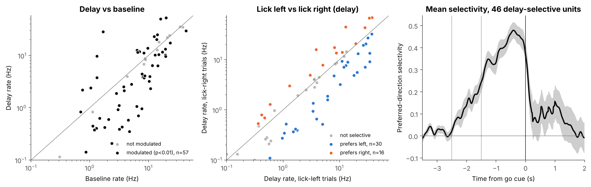
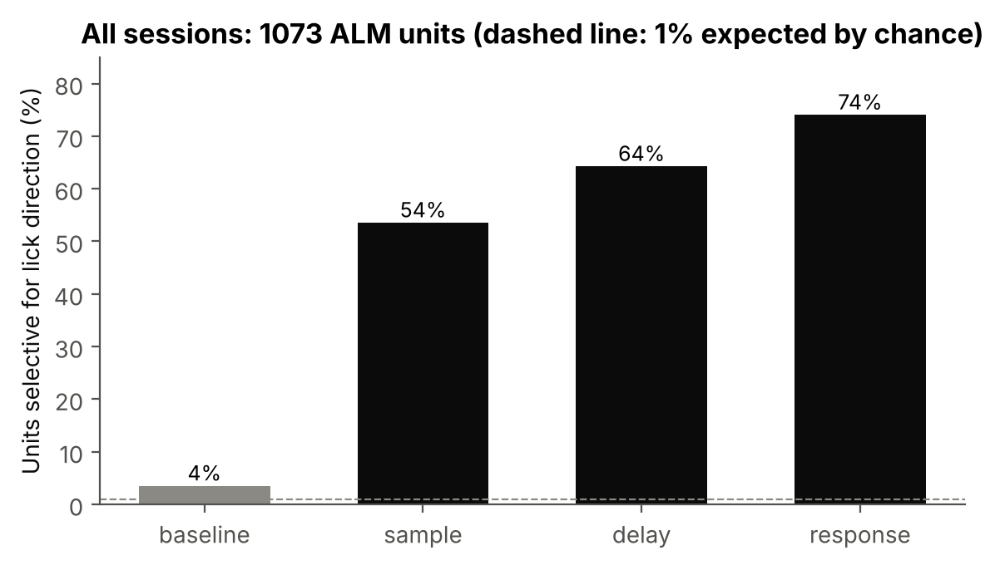

# Spike trains in mouse motor cortex during a delayed-response task



*One neuron from mouse anterior lateral motor cortex (ALM), aligned to the go cue. Each row of the raster is a trial; blue trials ended in a left lick, orange in a right lick. Before any movement, during the delay, this neuron fires about 35 Hz when the mouse is about to lick left and about 9 Hz when it is about to lick right.*

## What this project does

This notebook analyses raw single-neuron activity from the [DANDI Archive](https://dandiarchive.org), the NIH BRAIN Initiative's repository for neurophysiology data. It uses **[DANDI:000006](https://dandiarchive.org/dandiset/000006/0.220126.1855)** (version `0.220126.1855`), *Mouse anterior lateral motor cortex (ALM) in delay response task*, from Economo & Svoboda at Janelia Research Campus, which accompanies [Economo et al., *Nature* 2018](https://doi.org/10.1038/s41586-018-0642-9).

In the task a mouse feels a pole (**sample**), waits (**delay**), then on an auditory **go cue** licks left or right to report the pole's position. The notebook:

1. Lists and downloads the NWB files with the `dandi` Python client.
2. Reads trials, lick events and spike-sorted units with `pynwb`.
3. Tests the file's time convention against the lick data (licking starts a median 107 ms after the computed go cue).
4. Plots lick rasters, spike rasters and peri-stimulus time histograms (PSTHs) aligned to the go cue.
5. Compares firing rates across task epochs and between lick-left and lick-right trials, first in one session and then across all 53 sessions.

## Results

| | One session (`sub-anm369962`, 2017-03-13) | All 53 sessions |
|---|---|---|
| Recording time | 37.8 min | 26.8 h |
| Units analysed (≥ 0.5 Hz) | 69 | 1,073 |
| Direction-selective in baseline (control) | 0% | 4% |
| Direction-selective in sample | 51% | 54% |
| Direction-selective in delay | 67% | 64% |
| Direction-selective in response | 77% | 74% |

"Direction-selective" means the unit's firing rate in that epoch differs between lick-left and lick-right trials (Mann-Whitney U, p < 0.01, correct trials only).



**Interpretation.** Most ALM neurons carry information about which way the mouse will lick while it is still waiting to move, and that information grows through the sample and delay epochs and peaks just before the go cue. This is the signature of preparatory (motor-planning) activity. The baseline control sits at 4%, above the 1% expected by chance, which points to some slow drift or trial-history effect that a stricter analysis would remove. Because only correct trials are used, the analysis cannot separate the planned movement from the remembered pole position; error trials would be the next step.



## Setup

Requires Python 3.10 or newer. The whole dandiset is about 140 MB.

```bash
git clone https://github.com/PratapMahalingam/neuro-dandi-spike-trains.git
cd neuro-dandi-spike-trains
python -m venv .venv
source .venv/bin/activate          # Windows: .venv\Scripts\activate
pip install -r requirements.txt    # installs pynwb, the dandi client, numpy, scipy, matplotlib
jupyter lab analysis.ipynb
```

To install the NWB reader and DANDI client on their own:

```bash
pip install pynwb dandi
```

`pip install dandi` also installs the `dandi` command-line tool. To download the whole dandiset from the shell instead of from the notebook:

```bash
dandi download DANDI:000006/0.220126.1855
```

The notebook downloads files into `data/000006/` on first run and reuses them after that. It looks the files up through the DANDI API; if the API is unreachable it reads the same file list from the manifest DANDI publishes in its public S3 bucket.

## Project structure

```
analysis.ipynb      the full analysis, with outputs
figures/            figures saved by the notebook
requirements.txt
```

## Notes on working with NWB

Learning an unfamiliar scientific data format from documentation is an engineering skill. Two things in this dataset were not obvious from the docs alone and had to be checked against the data:

* The epoch times in the trials table (`pole_in_time`, `pole_out_time`, `cue_start_time`) are offsets from each trial's `start_time`, not session timestamps.
* On about 15% of trials labelled correct, the first lick within 1.5 s of the go cue is not on the side named by the trial type. The dataset does not document how outcomes were scored, so labels are used as given.

## Data citation

Economo, Michael N.; Svoboda, Karel (2022). *Mouse anterior lateral motor cortex (ALM) in delay response task* (Version 0.220126.1855) [Data set]. DANDI Archive. https://doi.org/10.48324/dandi.000006/0.220126.1855
